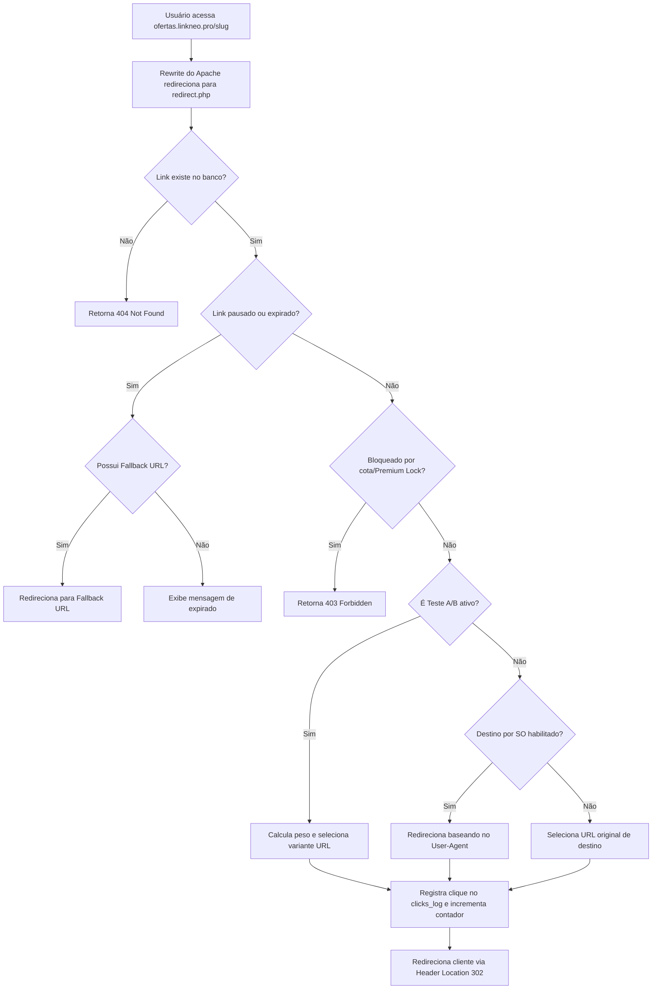

# Encurtou.pro - Backend Map

Este documento detalha o funcionamento e a arquitetura lógica do servidor (backend) do **Encurtou.pro**. Ele serve como um mapa prático para que futuras IAs saibam onde alterar regras de negócio, validar dados, criar novos endpoints, integrar serviços ou depurar falhas de processamento.

---

## ⚙️ Visão Geral da Arquitetura Backend
- **Paradigma:** Vanilla PHP estruturado em scripts endpoints individuais de roteamento que tratam requisições HTTP (GET/POST) e retornam respostas JSON ou renderizações HTML.
- **Camada de Dados:** Acesso unificado ao MySQL via extensão `PDO` declarada no arquivo de inicialização [`db.php`](file:///E:/encurtou/db.php).
- **Segurança Core:** 
  - Sessão endurecida via `ini_set` e SameSite Lax.
  - Validação centralizada de Tokens CSRF em requisições POST através da função `requireCsrfToken()`.
  - Validação de cotas e permissões de planos em tempo real por meio da classe [`EntitlementService`](file:///E:/encurtou/billing/EntitlementService.php).

---

## 📂 Organização dos Arquivos de Backend

```
E:\encurtou
├── db.php                     # Conexão PDO, sessão segura, CSRF middleware
├── redirect.php               # Motor de roteamento/redirecionamento de links curtos
├── bio.php                    # Renderizador público das Bio Pages
├── bio_helpers.php            # Utilitários de normalização de blocos e schemas de Bio
├── qr_helpers.php             # Processador de metadados e destinos de QR Code
├── auth.php                   # Endpoint de login, cadastro, reset e Google Auth
├── auth_guard.php             # Guard central: sessão, ban, e-mail verificado, CSRF
├── AbusePolicyService.php     # Política anti-phishing (blacklist, Web Risk, strikes)
├── abuse_policy_helpers.php   # SSRF, keywords, blocklist, audit log
├── report_abuse.php           # Denúncias públicas de links suspeitos
├── blocked.php                # Página de link bloqueado por segurança
├── run_abuse_rescan.php       # Cron: re-scan de links existentes
├── run_abuse_feed_sync.php    # Cron: sync URLhaus/OpenPhish
├── api.php                    # Endpoint de criação de links, QRs e testes A/B
├── analytics.php              # API de relatórios e dados de estatísticas de acesso
├── checkout.php               # API de checkout e integração de faturas Asaas
├── webhook_asaas.php          # Ponto de recepção do webhook de pagamentos do Asaas
├── manage_*.php               # APIs de CRUD de recursos (links, bios, times, formulários)
├── upload_*.php               # APIs de validação e salvamento de uploads de mídias
├── run_*_migration.php        # Scripts auxiliares para execução local de queries SQL
└── billing/                   # Pasta core do módulo financeiro e limites de uso
    ├── EntitlementService.php # Validador de cotas, limites e permissões por plano
    ├── SubscriptionService.php# Manipulador de assinaturas ativas no banco de dados
    ├── PlanService.php        # Serviço de planos e precificações
    └── webhook.php            # Processamento lógico e reconciliação da assinatura
```

---

## 🚦 Roteador e Redirecionamento (`redirect.php`)

Todas as requisições de links encurtados passam por [`redirect.php`](file:///E:/encurtou/redirect.php) (graças à regra rewrite do [`.htaccess`](file:///E:/encurtou/.htaccess)). O fluxo lógico de execução ocorre nas seguintes etapas:



---

## 🔒 Camada de Segurança e Middlewares

### 1. Hardening de Sessão e CSRF
O arquivo [`db.php`](file:///E:/encurtou/db.php) inicializa a sessão com flags estritas (`use_strict_mode`, `cookie_httponly`, `cookie_secure` em HTTPS, e `SameSite=Lax`). 
A função `requireCsrfToken()` verifica a integridade de requisições POST comparando o cabeçalho HTTP `X-CSRF-Token` com o token guardado na sessão (`$_SESSION['csrf_token']`). O bloqueio é controlado pela variável de ambiente `CSRF_ENFORCE` no Apache.

### 2. Controle de Cotas e Assinatura (`EntitlementService.php`)
A classe estática [`EntitlementService`](file:///E:/encurtou/billing/EntitlementService.php) intercepta requisições de criação de links/QR Codes e acesso a recursos premium (como domínios personalizados e A/B Testing). Ela calcula os recursos consumidos pelo usuário no mês atual (consultando `user_usage_monthly`, `links` e `bio_pages`) e os compara com as permissões do plano ativo do usuário (guardados em `plans`).

---

## 💳 Integração de Cobranças (Asaas Gateway)

O fluxo de pagamento é assíncrono:
1. O usuário seleciona um plano no painel -> [`checkout.php`](file:///E:/encurtou/checkout.php) gera uma transação na API do Asaas e retorna a URL de pagamento.
2. Após o pagamento do boleto/cartão/Pix, o Asaas dispara um webhook para [`webhook_asaas.php`](file:///E:/encurtou/webhook_asaas.php).
3. O endpoint valida o token e passa o payload para [`billing/webhook.php`](file:///E:/encurtou/billing/webhook.php).
4. O webhook processa o evento de pagamento, ativa/atualiza a assinatura em `user_subscriptions`, altera a coluna `current_plan_id` na tabela `users` do cliente e loga o payload em `billing_events_log`.

---

## 📝 Guia de Alterações: Onde Alterar?

- **Para alterar os limites padrões ou adicionar novas features no plano grátis/premium:**
  - Edite as propriedades no banco de dados e as definições lógicas em [`billing/configs.php`](file:///E:/encurtou/billing/configs.php) ou nos inserts iniciais em [`billing_schema.sql`](file:///E:/encurtou/billing_schema.sql).
- **Para adicionar novos parâmetros de rastreamento no redirecionamento (ex: parâmetros UTM adicionais):**
  - Altere a montagem da URL de destino em [`redirect.php`](file:///E:/encurtou/redirect.php).
- **Para alterar as regras de segurança no upload de logos de QR Code ou imagens de avatar:**
  - Ajuste as extensões permitidas e as validações de arquivo em [`upload_logo.php`](file:///E:/encurtou/upload_logo.php) ou [`upload_bio.php`](file:///E:/encurtou/upload_bio.php).
- **Para criar um novo endpoint de API:**
  - Crie o arquivo `.php` na raiz do workspace, inclua `require_once 'db.php'` no cabeçalho para garantir sessão e proteção CSRF, e faça as validações necessárias antes do processamento.
